# NOVA Swift


NOVA Swift is a reimplementation of the Escape Velocity Nova engine (Ambrosia
Software, 2002), written in Swift from a reverse-engineered reading of the
original executable. It runs natively on macOS, iPadOS, iOS and tvOS, with a
Godot frontend for Linux and Steam Deck (experimental beta) and Windows (not yet built).

It is not an emulator or a wrapper. The engine reads the game data from your
own copy of EV Nova and plays it. No game data is included.

[Website](https://sirstig.github.io/NovaSwift/) ·
[TestFlight beta](https://testflight.apple.com/join/3FBzwwq1) ·
[Plug-in catalog](https://github.com/SirStig/NovaSwift-Plugins) ·
[Issues](https://github.com/SirStig/NovaSwift/issues)

## Fidelity

The reference is the Windows release, EV Nova CE. Its executable was
disassembled and decompiled, and each gameplay system was compared against
NovaSwift and rewritten to match: flight, hyperjump and travel days, weapons
and damage, the NPC AI state machine, spawning, per-system legal record, the
economy, outfitter and shipyard, missions and control-bit scripting, the star
map, targeting, landing, Player Info, saving and Strict Play. Where a formula
was unclear, the original routine was run under emulation and its output
compared.

Original behaviour is the default. Anything that changes the rules is an opt-in
Enhancement and is off unless you turn it on.

No decompiled code is in this repository. The findings are written up as specs
with function addresses in [docs/reverse-engineering/](docs/reverse-engineering/README.md).


One block is roughly 5% of that part of the original code: compared and
matching or fixed to match (green), or handled differently on purpose, such as the
save format and controls (teal). Every row is now complete: 671 of 671 portable
functions. The number at the end of a row is matching functions out of the
functions to port, not a progress percentage. This tracks how much has been
checked, not how finished the game is. All 179 plan items are done; the last 16 were
finished on 2026-10-13 and are still being built and tested (see [docs/STATUS.md](docs/STATUS.md)). NovaSwift is in beta and has bugs. If something plays
differently from the original, please
[open a fidelity issue](https://github.com/SirStig/NovaSwift/issues/new/choose).
The function-by-function view is in [docs/STATUS.md](docs/STATUS.md) and on the
[website](https://sirstig.github.io/NovaSwift/progress.html).

<details>
<summary>Features beyond the original, and parts of the original that aren't needed</summary>


</details>

## Features

The full game is playable on all four Apple platforms: starting scenarios,
flight, combat, trade, outfitting, ships, missions and storylines, boarding and
capture, planet domination, escorts, and death with the original's
consequences. Plug-ins and total conversions load the way they do in the
original.

**Plug-in Editor (macOS).** A resource editor built into the app. It covers 23
resource types, each checked byte-for-byte against every stock record, plus
hex, text, graphics and sound editors with PNG and WAV import. It also has a
galaxy map editor (systems, hyperlinks, governments, nebulae) and a star system
editor with a live game preview. Story tools show a control-bit index and
mission flow graph. A linter, and saving as `.rez` or classic resource files,
round it out. A test run starts a game on your plug-in with a debug panel to
spawn ships and fleets, grant outfits, set bits, start missions and jump
anywhere. Known gaps are listed in [PLUGIN_EDITOR.md](docs/PLUGIN_EDITOR.md).

**Plug-in manager.** Install from the
[community catalog](https://github.com/SirStig/NovaSwift-Plugins), import your
own files (including old Mac `.sit` and `.hqx` archives), and enable, disable
or delete them. Setting your own load order is an opt-in Enhancement. Anyone
can add a plug-in to the catalog by pull request.

**Multiplayer.** Co-op over local Wi-Fi or Game Center on Apple devices, and
over LAN, by IP address or on a dedicated server you run yourself on the
Linux, Steam Deck and Windows builds. Each player keeps their own galaxy and
pilot; players in the same star system play it together, and the host sets
the rules: PvP, real damage, friendly fire, permadeath and trading. We run no
servers. See [MULTIPLAYER.md](docs/MULTIPLAYER.md).

**Pilots and iCloud.** Import Windows `.plt` pilots. Classic Mac pilot import
is in testing. Pilots save to iCloud on Mac, iPad and iPhone, and your imported
game data syncs through iCloud on every device, Apple TV included. See
[ICLOUD_SYNC.md](docs/ICLOUD_SYNC.md).

**HD art and 3D models.** Plug-ins can ship high-resolution sprites and 3D ship
and planet models. Models are baked into the classic sprite frames by default,
or drawn live in 3D (Settings ▸ Graphics), turning and banking with the ship.
Hit boxes and gameplay are unchanged either way. Apple platforms only; live 3D
is new and still being tested on hardware. See [HD_PIPELINE.md](docs/HD_PIPELINE.md).

**Debug suite.** Searchable live logs, frame time per subsystem, a ship and
planet inspector, and a command console. Settings ▸ Support ▸ Report a Bug
bundles your pilot and logs for an issue report.

**Everything else.** Classic, Enhanced and Nova Swift presentation presets with
per-item overrides. Touch controls, and controller support on every platform
([CONTROLS.md](docs/CONTROLS.md)). A Story Guide and storyline map. An Apple TV
interface ([TVOS.md](docs/TVOS.md)). Opt-in Enhancements in
Settings ▸ Enhancements, all off by default: manual plug-in order, frequent
autosave, quick hyperjump, forgiving landing, automatic route plotting,
nearest-first targeting, a modern key layout and tight formations.

## Screenshots

| Plug-in Editor: galaxy map | Plug-in Editor: test run |
|---|---|
| 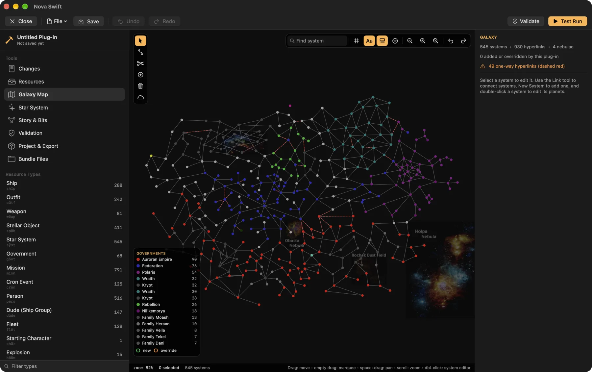 | 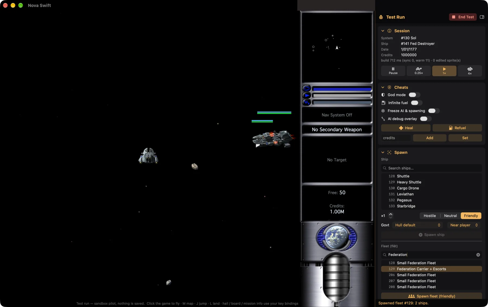 |

| Plug-in Editor: ship | Plug-in Editor: star system |
|---|---|
| 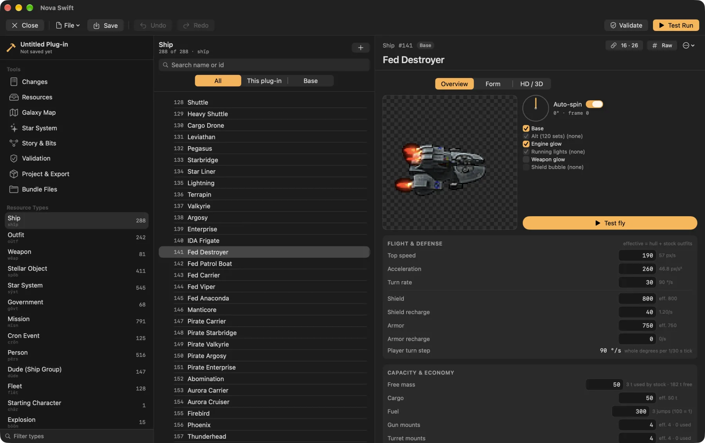 | 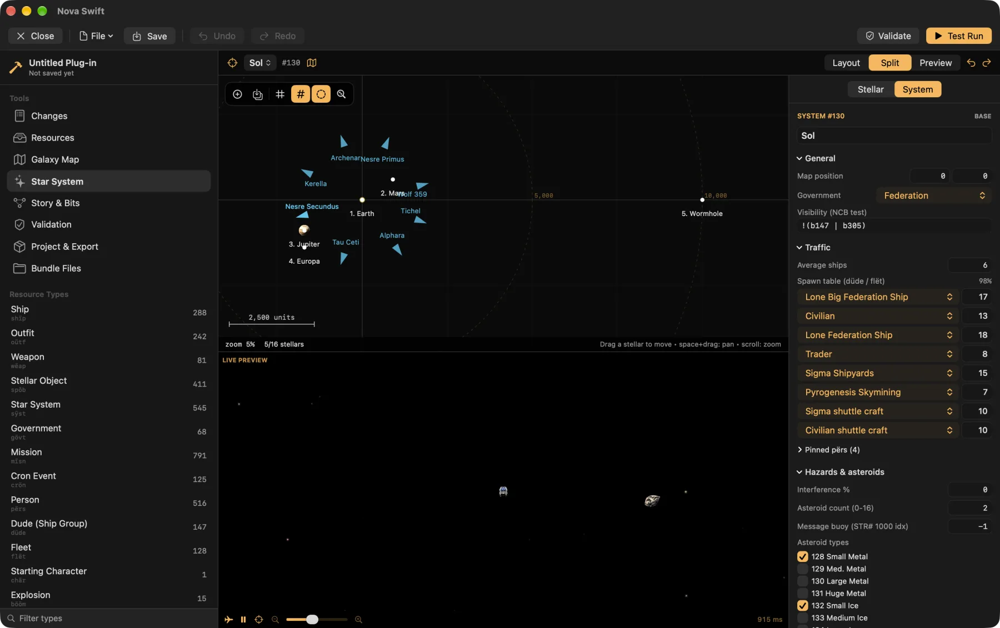 |

| Flight (iPhone) | Galaxy map |
|---|---|
| 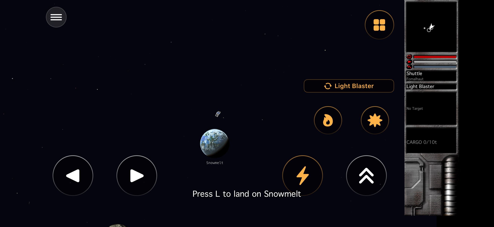 | 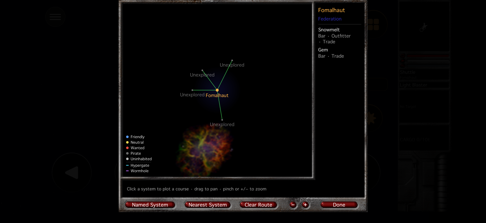 |

| Story Guide | Host lobby |
|---|---|
| 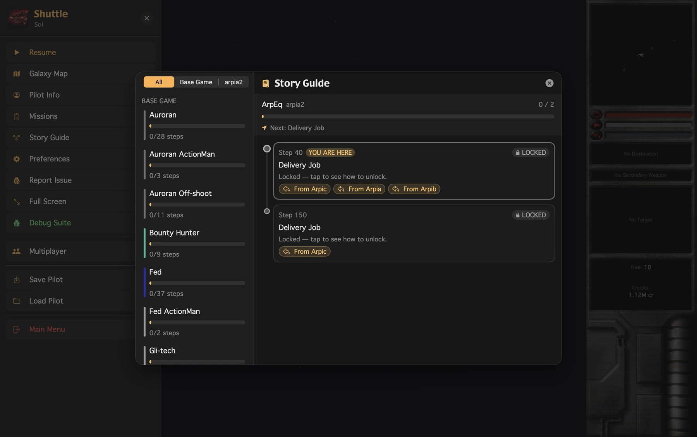 | 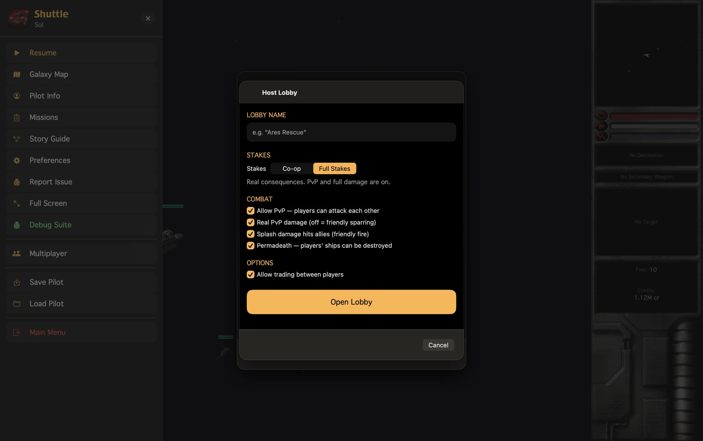 |

| Plug-ins | Debug suite |
|---|---|
| 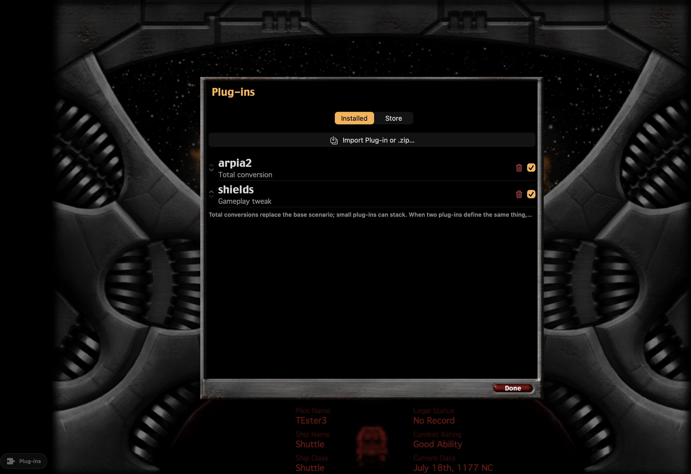 | 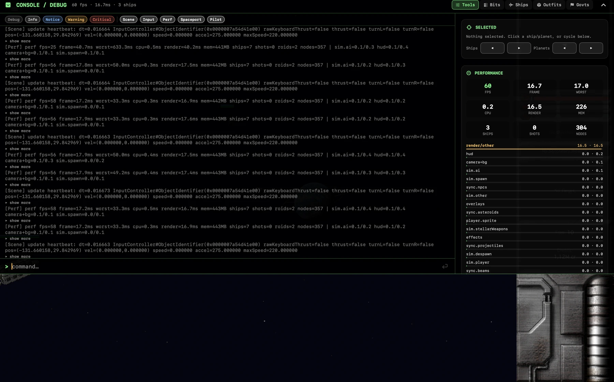 |

| Presentation presets | Story map |
|---|---|
| 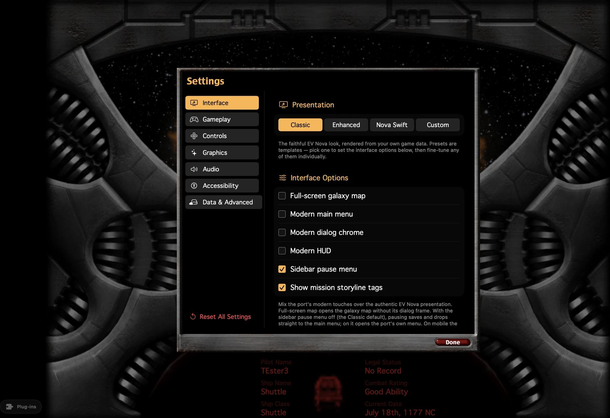 | 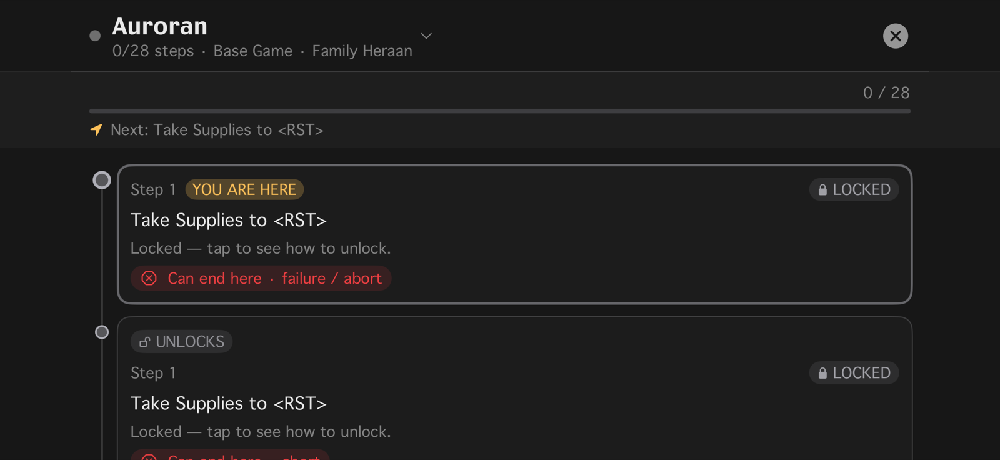 |

## Playing

Join the [TestFlight beta](https://testflight.apple.com/join/3FBzwwq1) for Mac,
iPad, iPhone or Apple TV, then point the app at your EV Nova data:
[GET_THE_DATA.md](docs/GET_THE_DATA.md).

| Platform | Get it |
|---|---|
| macOS, iPad, iPhone, Apple TV | The native Apple app: [TestFlight beta](https://testflight.apple.com/join/3FBzwwq1). Recommended on Mac. |
| Linux x86_64 and Steam Deck | Godot build from [GitHub Releases](https://github.com/SirStig/NovaSwift/releases): `NovaSwift-linux-x86_64.tar.gz` (see [below](#linux-and-windows)). |
| Windows | Coming soon. It needs a Windows build. |
| macOS (alternative) | Godot build `NovaSwift-macos-arm64.zip` from the same Releases page, for testing only. |

Report bugs in the [issue tracker](https://github.com/SirStig/NovaSwift/issues).
Settings ▸ Support ▸ Report a Bug collects a diagnostics bundle you can attach.

## Building

Requires a Mac with Xcode. `data/base/` is git-ignored, so your game data stays
on your machine.

```bash
git clone https://github.com/SirStig/NovaSwift.git
cd NovaSwift
scripts/setup.sh                # open-source dependencies
# copy your EV Nova data into data/base/ (see docs/GET_THE_DATA.md)
scripts/fetch-plugins.sh        # optional: free community plug-ins
swift build && swift test       # command-line check
open app/NovaSwift.xcodeproj    # pick a target and Run
```

### Linux and Windows

The data layer, simulation and story runtime are portable Swift. Only the UI
and rendering use SwiftUI and SpriteKit. The Godot 4 frontend, bridged with
[SwiftGodot](https://github.com/migueldeicaza/SwiftGodot), runs the same
`World.step` as the Apple build. On macOS it plays a pilot through flight,
combat, landing, the spaceport, missions, the galaxy map, sound, saving and the
story runtime, and loads all 13 catalog plug-ins.

**Download.** The Godot build is on the
[GitHub Releases page](https://github.com/SirStig/NovaSwift/releases). The first
release is the pre-release `v0.7.0-beta.1`, an experimental beta of the Godot
version (0.7.0). Open the Releases page rather than "latest", which skips
pre-releases. Assets:

- `NovaSwift-linux-x86_64.tar.gz`: Linux x86_64 and Steam Deck. Built and checked
  headless in a clean Ubuntu 22.04 container; not yet run on a real Steam Deck or
  with a GPU.
- `NovaSwift-macos-arm64.zip`: macOS on Apple silicon. For testing; on a Mac the
  native Apple app above is the better choice. It is not notarised, so
  right-click the app and choose Open the first time.
- Windows (x86_64): coming soon. `scripts/package-windows.ps1` is written but has
  never been run; it needs a Windows PC with the Swift toolchain.

**First run (Linux and Steam Deck).**

1. Extract the tarball anywhere, for example `~/Games/NovaSwift`.
2. Run `NovaSwift.sh`.
3. On a Steam Deck, add `NovaSwift.sh` to Steam as a non-Steam game to play in Game Mode.
4. You need your own copy of EV Nova data; the setup wizard imports it on first
   launch ([GET_THE_DATA.md](docs/GET_THE_DATA.md)).
5. Optional: install `ffmpeg` to play the original movies.

If you would rather build it yourself, see [docs/PACKAGING.md](docs/PACKAGING.md).

The Godot build checks GitHub for updates (Settings ▸ Support ▸ Updates; experimental
builds only appear if "Experimental updates" is on) ([docs/UPDATER.md](docs/UPDATER.md)):
signed releases, a prompt with Skip This Version / Later / Update Now, an opt-in
experimental channel and a way back to stable. It is built but not yet tested end
to end. Work from the latest rounds (original status-line text and travel hints,
quick hyperjump, the original Key Settings window, `.mov` title music, folding
hulls) is written but not yet built or tested. The per-subsystem table is in
[docs/STATUS.md](docs/STATUS.md#linux-and-windows); the design is in
[GODOT_LAYER.md](docs/GODOT_LAYER.md).

## Repository layout

```
docs/                    Charter, status, roadmap, architecture, formats, RE specs
Sources/
  NovaSwiftKit/          Resource parsing, typed decoders, sprite/PICT codecs, plug-in editing
  NovaSwiftEngine/       Simulation: flight, combat, AI, spawning, diplomacy
  NovaSwiftStory/        Missions, crön events, NCB scripting, pilots, economy
  NovaSwiftNet/          Multiplayer transports (Game Center, local Wi-Fi), sessions
  NovaSwiftSync/         Multiplayer world-state sync
  NovaSwiftPluginStore/  Plug-in catalog, download and install
  novaswift-extract/     Command-line inspector and test harness
Tests/                   Unit tests per library
app/NovaSwift/           SwiftUI/SpriteKit app, including the Plug-in Editor
godot/                   Godot 4 frontend and SwiftGodot bridge
data/base/               Your EV Nova data (git-ignored)
```

## Documentation

[docs/README.md](docs/README.md) is the index. Start with the
[Charter](docs/CHARTER.md), [Status](docs/STATUS.md),
[Roadmap](docs/ROADMAP.md), [Architecture](docs/ARCHITECTURE.md),
[Data format](docs/DATA_FORMAT.md), [Plug-in Editor](docs/PLUGIN_EDITOR.md) and the
[reverse-engineering specs](docs/reverse-engineering/README.md).

## Contributing

Bug reports, fidelity reports and pull requests are welcome; the issue tracker
has templates for each. Plug-ins go to
[NovaSwift-Plugins](https://github.com/SirStig/NovaSwift-Plugins). Please don't
attach or commit EV Nova data files.

## Legal

EV Nova and its data are copyrighted by their owners. This project does not
redistribute them.

- Game data: you need your own copy of EV Nova. NOVA Swift only reads it.
- Community plug-ins: the catalog links to public downloads. A plug-in is only
  rehosted when its readme allows redistribution, and authors can ask for removal.
- Code: open source, see [LICENSE](LICENSE).

The reverse-engineering docs describe behaviour in prose, short formulas and
constants. No decompiled code is included.

NOVA Swift is a fan preservation and interoperability project in the spirit of
OpenRA, OpenTTD and devilutionX. It is not affiliated with or endorsed by
Ambrosia Software, ATMOS or the original authors.
